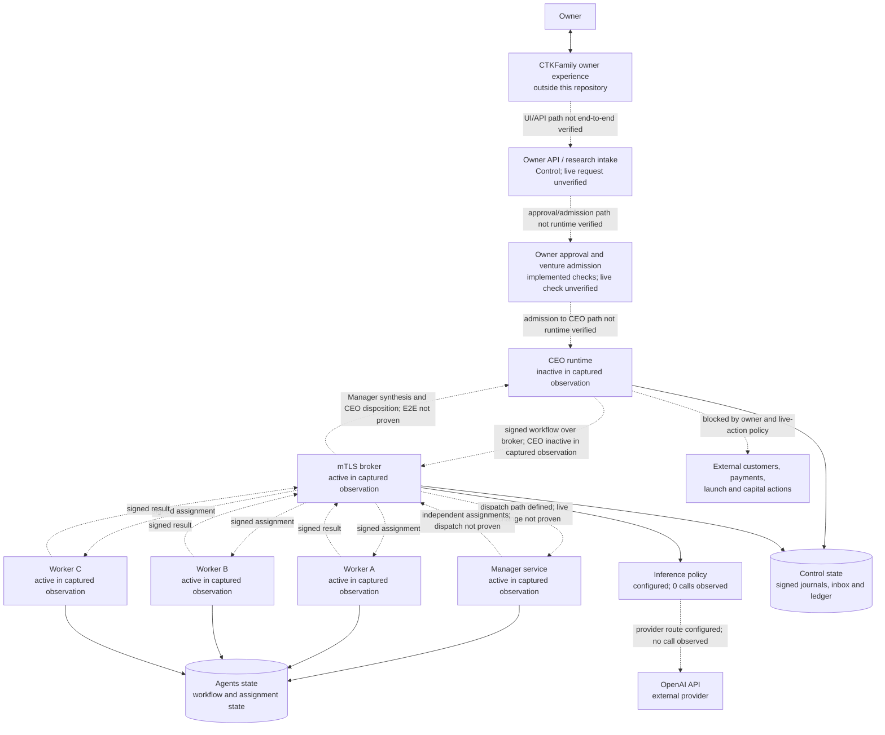

# AVA Architecture and Connection Status

**Diagram type:** current logical and deployment architecture

**Repository baseline:** `main` at `1f30440`
**Runtime evidence baseline:** Control and Agents observations captured for the Level 2D activation on 2026-10-31. This is evidence of that observation, not a live health check for today.

## Architecture diagram

Solid arrows show a connection or handoff defined by the repository architecture. The status labels qualify whether runtime execution was observed. Dashed arrows identify connections whose end-to-end operation was not established by the cited evidence.

## What the evidence establishes

| Area | Status | Evidence and limit |
|---|---|---|
| Control broker | Active in the captured observation | The activation evidence records the mTLS broker as active. It does not prove that a venture completed a full workflow through it. |
| CEO | Inactive in the captured observation | The authenticated Control verification reports `ceo_inactive: true`; the requested multiworker workflow was absent and acceptance was `BLOCKED`. |
| Manager and Workers A/B/C | Service units observed active | The Agents observation lists the Manager and all three Worker units as active/running. The observation did not execute the staged operator activation, and it does not prove assignment dispatch or result return. |
| Worker identity | Three distinct pins observed | The Control verification reports three distinct registered Worker pins and role bindings for worker-a, worker-b, and worker-c. Certificate issuer and expiry were not established in this evidence. |
| Central inference provider | Configured, not exercised | The captured policy names the OpenAI API and `gpt-6-luna`; provider calls were zero and quota remaining was zero at verification. Configuration is not proof of a successful API connection. |
| Durable state | Local state and backup relationship partly verified | The captured Control verification reports identical rows for `hierarchy/inbox.sqlite`, `hierarchy/workflow.sqlite`, and `resources.sqlite` versus their backups. This does not inventory every runtime database or host. |
| CTKFamily owner path | Not end-to-end verified here | Owner API, reverse-tunnel, and research-intake components exist in the project, but the cited activation evidence does not demonstrate a browser-to-API transaction. |
| Manager synthesis and CEO disposition | Architecture path defined; acceptance incomplete | Existing signed workflow components support the roles. The captured run did not demonstrate the complete CEO→Manager→Workers→Manager→CEO path. |
| Live external actions | Not enabled by this diagram or evidence | No customer contact, payment, launch, or capital action is authorized by this architecture snapshot. |

## Connection inventory

| From | To | Mechanism represented in code/config | Connection state |
|---|---|---|---|
| Owner | CTKFamily | Owner-facing site | External to this repository; live browser path not verified by cited evidence. |
| CTKFamily | Owner API / research intake | Owner API and tunnel-related services | Components exist; current end-to-end request not verified. |
| CEO | Manager | Signed workflow commands through the central broker | Implemented path; CEO was inactive in the captured activation observation. |
| Manager | Workers A, B, C | Role-bound, independently assigned work through the broker | Units and identity pins observed; actual dispatch/result round trip not proven. No fixed A/B→C dependency is represented. |
| Workers A, B, C | Manager | Signed work results | Defined in the hierarchy; runtime result delivery not demonstrated in the cited run. |
| Manager | CEO | Manager review/synthesis followed by signed disposition | Defined role; end-to-end completion not demonstrated. |
| Inference governance | OpenAI API | Configured provider policy and bounded request settings | Route configured; zero calls in the captured verification. |
| Runtime services | Local SQLite state | Signed workflow, inbox, and ledger state | Specific backup equality verified on Control; complete host/storage topology not audited. |
| AVA | Customers, payments, launch, capital | No enabled path established by this snapshot | Outside current verified/authorized operation. |

## Scope and caveats

This diagram describes the repository architecture and the last included runtime evidence. The architecture source includes the CEO control plane, signed workflow, owner approval/admission, centralized broker and provider governance, Manager/Worker hierarchy, and local durable state. It does not claim that all components are currently running or connected.

The activation record explicitly classified acceptance as blocked, recorded zero provider calls, and recorded the CEO as inactive. Agents service metadata showed the Manager and Workers A/B/C running, while the staged Agents operator was not executed. Re-check both VMs and run the authorized end-to-end acceptance flow before treating any dashed connection as operational.

This file is a logical architecture diagram, not a network exposure inventory. It does not publish host IP addresses, DNS names, load-balancer/CDN mappings, certificate serials or expiry dates, or secrets. Those require a separately verified infrastructure and certificate inventory.
