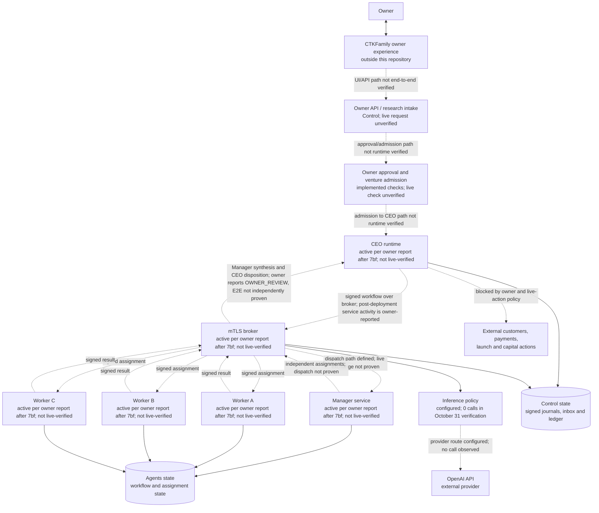

# AVA Architecture and Connection Status

**Diagram type:** current logical and deployment architecture

**Repository baseline:** `main` at `da81918eb0f7e6f5b6c7b98353d665adb9812c0e`

**Latest code baseline:** `main` at `1f30440`; later commits `3775a62` and `da81918` changed documentation only.

**Deployment report:** The owner reported deployment of `7bf015dd7045c9bd4d955244f06c5bc2d829dec6` to Control and Agents on November 3, 2026. This update did not independently verify VM state or installed revisions.

**Historical runtime evidence:** Control and Agents observations captured for the Level 2D activation on October 31, 2026. Those observations predate the reported deployment; they are retained as historical evidence, not current health.

## Architecture diagram

Solid arrows show a connection or handoff defined by the repository architecture. The status labels qualify whether runtime execution was observed. Dashed arrows identify connections whose end-to-end operation was not established by the cited evidence.

## What the evidence establishes

| Area | Status | Evidence and limit |
|---|---|---|
| Control broker | Owner reports active after deployment of 7bf015d | Not independently checked in this update. The October 31 activation record also showed the broker active, but does not prove a work transaction. |
| CEO | Owner reports active after deployment of 7bf015d | Not independently checked in this update. The October 31 verification reported it inactive before the later deployment claim; retain that as historical evidence. |
| Manager and Workers A/B/C | Owner reports all active after deployment of 7bf015d | The October 31 Agents observation also listed all four units active. Neither observation in the repository proves current dispatch/result traffic; this update did not inspect live services. |
| Worker identity | Three distinct pins reported in October 31 verification | That verification named worker-a, worker-b, and worker-c. Current certificate issuer, expiry, and runtime use were not rechecked. |
| Central inference provider | Configured, not exercised in October 31 verification | The captured policy names the OpenAI API and `gpt-6-luna`; provider calls were zero and quota remaining was zero in that verification. No newer provider call was reported. Configuration is not proof of a successful API connection. |
| Durable state | Local state and backup relationship partly verified | The captured Control verification reports identical rows for `hierarchy/inbox.sqlite`, `hierarchy/workflow.sqlite`, and `resources.sqlite` versus their backups. This does not inventory every runtime database or host. |
| CTKFamily owner path | Not end-to-end verified here | Owner API, reverse-tunnel, and research-intake components exist in the project, but the cited activation evidence does not demonstrate a browser-to-API transaction. |
| Manager synthesis and CEO disposition | Owner reports latest Manager log at `WAITING / OWNER_REVIEW` after deployment | The log and A/B/C outputs were not included here; the full CEO→Manager→Workers→Manager→CEO path is not independently verified by this update. |
| New assignment behavior | Independent A/B/C assignments enforced in current source; legacy replay retained | `bc94c17` introduced three distinct Workers and independent new assignments. `7bf015d` preserves faithful replay of older signed plans where C depends on A and B; new proposals still enforce empty dependencies. |
| Focused validation | Owner reports 110 focused tests passed for 7bf015d | The command and raw result were not supplied in this update; no test was rerun here. This is not a new full-suite or coverage result. |
| Live external actions | Not enabled by this diagram or evidence | No customer contact, payment, launch, or capital action is authorized by this architecture snapshot. |

## Connection inventory

| From | To | Mechanism represented in code/config | Connection state |
|---|---|---|---|
| Owner | CTKFamily | Owner-facing site | External to this repository; live browser path not verified by cited evidence. |
| CTKFamily | Owner API / research intake | Owner API and tunnel-related services | Components exist; current end-to-end request not verified. |
| CEO | Manager | Signed workflow commands through the central broker | Owner reports both services active after 7bf015d; not live-verified here. October 31 evidence of an inactive CEO is historical. |
| Manager | Workers A, B, C | Role-bound, independently assigned work through the broker | New proposals require distinct Workers and empty dependencies; the Manager chooses the task split. 7bf015d permits only legacy signed-plan replay with C dependent on A/B. Owner reports services active; dispatch/result round trip not independently verified. |
| Workers A, B, C | Manager | Signed work results | Defined in the hierarchy; runtime result delivery not demonstrated in the cited run. |
| Manager | CEO | Manager review/synthesis followed by signed disposition | Defined role; owner reports WAITING at OWNER_REVIEW after 7bf015d, but the log and underlying results were not independently inspected. |
| Inference governance | OpenAI API | Configured provider policy and bounded request settings | Route configured; zero calls in the captured verification. |
| Runtime services | Local SQLite state | Signed workflow, inbox, and ledger state | Specific backup equality verified on Control; complete host/storage topology not audited. |
| AVA | Customers, payments, launch, capital | No enabled path established by this snapshot | Outside current verified/authorized operation. |

## Scope and caveats

This diagram describes the repository architecture and the last included runtime evidence. The architecture source includes the CEO control plane, signed workflow, owner approval/admission, centralized broker and provider governance, Manager/Worker hierarchy, and local durable state. It does not claim that all components are currently running or connected.

The October 31 activation record explicitly classified acceptance as blocked, recorded zero provider calls, and recorded the CEO as inactive. Agents service metadata showed the Manager and Workers A/B/C running, while the staged Agents operator was not executed. The owner later reported deployment of 7bf015d, active CEO/broker/Manager/A/B/C services, recovered transient broker 503s, and Manager WAITING at OWNER_REVIEW. Those later statements were not independently verified in this update. Re-check both VMs and the associated logs before treating dashed connections as operational.

This file is a logical architecture diagram, not a network exposure inventory. It does not publish host IP addresses, DNS names, load-balancer/CDN mappings, certificate serials or expiry dates, or secrets. Those require a separately verified infrastructure and certificate inventory.

## Source and deployment reconciliation — November 3, 2026

The current pushed repository is at `da81918eb0f7e6f5b6c7b98353d665adb9812c0e`; the latest code change is `1f30440`. The reported deployed revision is `7bf015dd7045c9bd4d955244f06c5bc2d829dec6`. Commit `1f30440` contains source changes after `7bf015d`; commits `3775a62` and `da81918` update the architecture documentation. No deployment of `1f30440` or later was established in this update. Therefore, this diagram describes current source topology and an owner-reported earlier deployment separately.

The A/B/C behavior is:

- **New proposals:** three distinct registered Workers, each with an independent assignment. The Manager controls decomposition and consolidates results.
- **Older signed proposals:** replay may preserve the historic C-depends-on-A-and-B relationship and reconstruct its blocked/ready states.
- **Not a new-plan rule:** replay compatibility does not authorize dependencies in new proposals.

The owner also reported 110 focused tests passed, all listed services active after deployment, and broker 503s recovered. These remain owner-reported because no test output, current VM service query, or Manager log was examined for this update.
