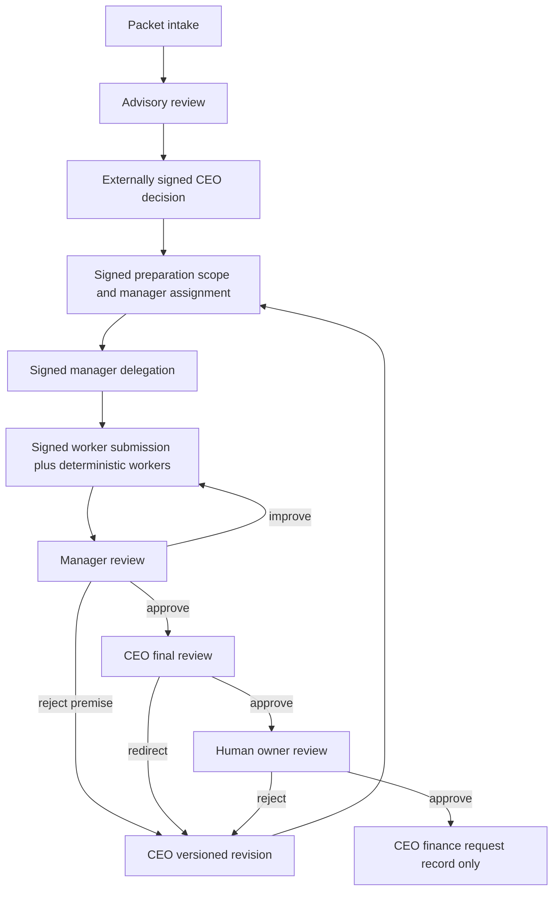

# CEO preparation control plane v1.0

Implemented on 2026-10-27 against main 866a9cf867b511aa24f6ce802ea5882adc20dcf3.
This is an implementation/recovery guide, not a policy amendment, phase
acceptance or grant of authority. The [owner approval policy](owner-venture-approval-policy-v1.0.md)
and all existing live denials apply. Venture #1 remains unapproved.

## Actual architecture

`agents.ceo.control_plane` is a local, headless, bounded JSON command spool and
status CLI. It reuses EscalationInbox and VentureWorkflow, and invokes the
existing `kernel.synthetic_orchestration.run_synthetic_orchestration` worker
registry for signed synthetic submissions. It never imports a worker selected
by a path, executes submitted code, signs a receipt, loads private keys or invokes
a provider. Its systemd oneshot template denies network access.

The existing scheduled_intake/scheduled_escalation path remains responsible for
hash-pinned Studio intake and a single explicitly budgeted advisory CEO request.
Its grant verification, configuration fingerprint, pre-model gate, durable
reservation and no-automatic-paid-retry rules are unchanged. To consume its
actual inbox, the operator explicitly supplies `--inbox-database` pointing to
that project's scheduled `escalations.sqlite`. Without this option the service
uses a separate local inbox. Do not point the workflow database at an inbox.



All actor arrows require externally produced Ed25519 signatures. Tests alone
generate ephemeral synthetic actors. No real signed decisions, owner receipts,
keys or provider budget grants are produced by this service. Automatic signing,
operational manager execution and real autonomous inference remain unconnected.
An advisory HANDOFF recommendation never substitutes for an authenticated CEO
decision. An authenticated preparation decision never substitutes for venture
admission or live authority.

The existing pilot Manager/AgentManager runtime was inspected, including its
containment, task dependencies, correction limits, provider reservation, online
HTTP and browser harness. The service does not execute or modify those
pre-existing owner runtime files. It integrates the tracked pure worker runtime;
there is no inference-capable AgentManager dispatch from this service.

## Contracts and durable state

Requests are exact JSON objects `{"operation": "...", "body": {...}}`.

| Operation | Exact body fields | Effect |
|---|---|---|
| ingest | item_id, venture_id, source, packet | Bounded UTF-8 packet intake |
| review | item_id, review | Advisory import, operator_supplied provenance |
| decision | item_id, receipt, signature | Existing authenticated inbox receipt verification |
| create | item_id, command, signature | Existing signed handoff and scope binding |
| apply | command, signature | Existing signed review/control transition |
| worker | command, signature, synthetic_input | Deterministic workers and atomic signed result recording |

`review` uses the exact EscalationInbox review schema. It cannot claim provider
provenance. Actual scheduled provider reviews retain
`configured_provider_not_independently_verified`; neither classification
independently proves remote model execution.

Commands retain VentureWorkflow.COMMAND_FIELDS and existing role, origin,
validity, revision, previous snapshot hash, proposal version, scope hash and
evidence validation. No unknown operation, live flag, role enrollment, tool,
provider setting, executable or finance adapter is accepted.

Worker commands must be worker-role `submit` actions with positive units.
`synthetic_input` has exactly `proposal` and `manager_plan`, using the existing
worker contract. Plan objectives must exactly match the scope's task list, and
the proposal venture must match the workflow. Workers remain the closed
summarize_evidence/calculate/checklist registry, with its existing three-task
and input/output bounds. The signing actor must include
`{"ref":"synthetic-result-HASH","sha256":"HASH"}` in command evidence, where
HASH is SHA-256 over canonical JSON of the complete deterministic result.
The service computes and verifies this result before accepting it.

SQLite `preparation.sqlite` stores workflow snapshots, signed audit history,
complete synthetic outputs and a separate delivery_attempts hash chain.
Worker output, effort consumption, state change and successful-transition audit
commit in one FULL-synchronous transaction. Result bytes and signed evidence
are verified again on read/restart. State verification reconstructs security
fields from signed commands, detecting final-state rewrites even when a local
attacker recomputes the final unsigned audit hash.

Eight distinct synthetic result artifacts and 100 revisions bound each
workflow; existing workflow event/item capacity limits also apply. Signed
control actions preserve HOLD/SECURITY_HOLD/TERMINATED gates. Revisions retain
effort consumption, clear prior approvals, and require the complete review
sequence again. Finance is a REQUEST_ONLY record capped by signed scope;
no allocator or payment adapter is called. A workflow owner receipt is a
preparation review attestation, not an imported VentureAdmissionRegistry
operational approval.

## Safe invocation and service setup

Operate from the project root. Use a dedicated private operator-owned state
directory. No provider environment is needed. Public-key configuration is a
protected, operator-owned JSON file:

```json
{"actors":{}}
```

Empty trust supports intake/status only and cannot authorize a decision.
For independently established actors the configuration shape is
`{"actors":{"ACTOR_ID":{"role":"ROLE","public_key":"64_HEX_CHARACTERS"}}}`.
Keys are public Ed25519 keys pinned outside the agent/request channel. Roles
are ceo, manager, worker, owner and security. Duplicate keys, invalid roles and
multiple CEO/owner identities are denied. Never place private keys here.
Do not populate trust from model output or generate a replacement owner key.

```sh
python3 -m agents.ceo.control_plane --state-dir artifacts/preparation-control/state --trust-file artifacts/preparation-control/trust.json
python3 -m agents.ceo.control_plane --state-dir artifacts/preparation-control/state --trust-file artifacts/preparation-control/trust.json --requests-dir artifacts/preparation-control/requests
```

No requests directory means verified counts and residual gates only. Python
`ControlPlane.status()` provides full verified snapshots to trusted local
operators; the CLI intentionally keeps packet/command contents out of journald.
A tick processes at most 32 sorted *.json files, each at most 128 KiB.
Malformed, duplicate-field, nonfinite, symlink, hardlink and oversized inputs
fail closed. Hash-derived outcome filenames prevent request-selected writes.
A process lock serializes CLI ticks. Exit 0 means successful status/tick; exit 4
means a denied request or service failure. Requests remain in the spool.

`infrastructure/systemd/venture-preparation-control.service` is a validated
oneshot template using venture-ceo, no provider environment, strict filesystem
protection, no capabilities and AF_UNIX-only networking. It writes only its
dedicated project-contained state directory. It requires pre-existing
operator-protected trust and request directories. The template was not installed
or enabled: this execution was confined to the approved project root. No timer,
host permission, credential injection or network allowance was changed.

The operator must isolate state, public-key configuration, SQLite files and
the ingress from agents. Directory ownership checks and signatures are not
an OS security boundary between processes sharing one Unix identity. This is
local SQLite service plumbing, not authenticated remote transport, production
multi-tenant hosting, PostgreSQL orchestration or arbitrary code isolation.

## Recovery and operator impact

Retain immutable request bytes and request IDs. Successful signed command
replay returns the original snapshot without consuming effort or advancing
state again. Different content under a used signed request ID is denied.
Different synthetic input under a previously accepted signed result binding
is denied. Expired signatures remain denied even for service replay: inspect
existing verified state instead of renewing or re-signing automatically.

A crash before the workflow transaction commits rolls back output/state/audit.
A crash after commit but before delivery logging or outcome-file replacement
is recovered by replaying the same signed request. Delivery attempts record
RECORDED/DENIED and request digest, with timestamps and a bounded hash chain.
Outcome files are the latest delivery observation, not authority. They may be
recreated from a tick; workflow state and signed history are authoritative.
A rejected dependency can be retried on a later explicit tick; stale state still
requires the authorized actor's new command. There is no automatic provider
retry or automatic revision/owner approval.

Inbox handoff export and workflow creation use separate databases. A crash
between them may leave an exported handoff without a workflow; retry the same
signed create while the receipt is current. Export is idempotent and grants no
execution capability. Never invent a replacement receipt to repair it.

Stop on integrity failure, capacity exhaustion, database corruption, expired
approval or unknown spend. Preserve the databases, sidecars and raw commands;
do not delete markers or repair audit hashes in place. Back up state only while
all writers are stopped or with SQLite's online backup facility, and verify
restored state with the original pinned keys before another tick. Complete
database rollback or deletion/replacement of a delivery chain requires an
external audit anchor to detect; local chains alone cannot establish freshness.

## Residual gates

1. A real bounded CEO review still needs the already defined trusted operator
   budget grant, reconciled remaining budget and protected provider configuration.
   No such grant was supplied or created in this execution.
2. Real CEO and other actor decisions need their independently authorized
   signers and pinned public keys. The runtime deliberately contains no signer.
3. Operational manager admission needs actual human owner discussion and the
   exact current proposal/version/scope approval through the separate owner
   admission policy. Venture #1 has no grandfathered approval.
4. Any provider-backed manager/worker execution needs its own approved budget
   and authenticated dispatch integration; this service invokes only pure
   synthetic workers.
5. Online Studio acceptance needs an accessible complete backend/application
   artifact and the existing private HTTP plus real-browser gate. Browser
   availability or passing offline worksheet tests does not establish it.
6. Live funds, customer contact, deployment, public launch and all nine live
   authorities remain denied. No review result changes phase acceptance or /49.
